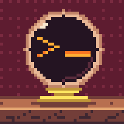
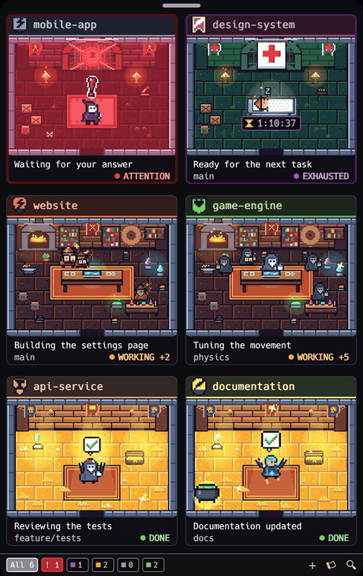
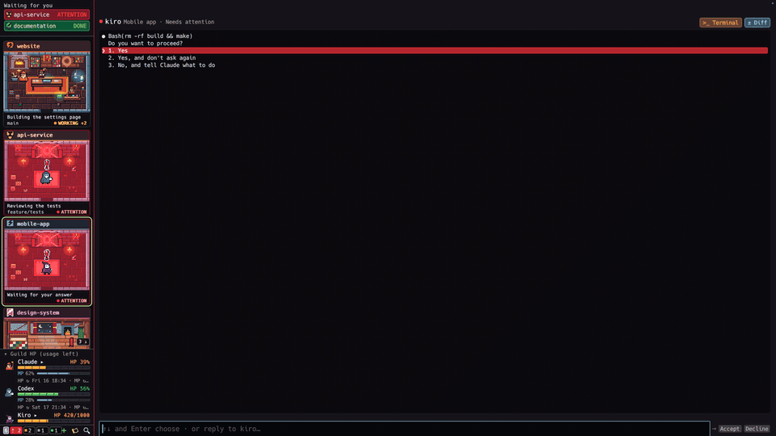
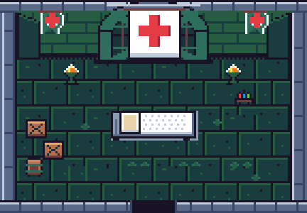
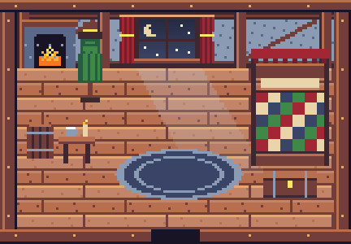
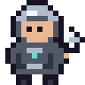

<p align="center"></p>

# Agents Pixel Dungeon

**A native pixel-art guild for your live [Herdr](https://herdr.dev) agents, for macOS, Linux and Windows.** Made by [Diabolo Studio](https://diabolostudio.com/).

Each coding agent is a hero in a dungeon room that changes with its real Herdr status: working at the forge, asking for your attention, exhausted on an infirmary cot until its usage limit resets, reading while it waits, done. Click a room to answer the agent, accept or decline its permission prompts, or summon a new one. Rust, `egui`, a status item in the menu bar or tray, no browser or server.

<p align="center">
  
</p>

<p align="center">
  
</p>

<p align="center"><a href="docs/media/demo.mp4">Watch the full demo video</a> · <a href="docs/media/widget.png">Full-size screenshot</a> · <a href="docs/GUIDE.md">Guide</a></p>

## Download

Binaries for macOS (`.app`), Linux (x86_64) and Windows (x86_64, a portable `.zip`) are on the [Releases](https://github.com/JoseValencia125/agents-pixel-dungeon/releases) page. The macOS app is ad-hoc signed, not notarized: the first time, right-click it and choose Open. The Windows build is not code-signed, so SmartScreen may ask you to confirm the first run.

## States and rooms

| Herdr state | | Room | Hero |
| --- | --- | --- | --- |
| `working` |  | Workshop: desk, bookshelves, forge, alchemy table | Works at the station of its last tool: reads, forges, brews, summons, plans or types |
| `blocked` |  | Sealed door, braziers, a rug | Jumps on the rug under a pulsing red "!" |
| session limit |  | Infirmary with a cot under the red cross | Exhausted, asleep on the cot under a breathing blanket, with the time left to recover until the reset |
| `idle` |  | An inn's bedroom at night: a canopy bed, a hearth, the moon through the window | Reads in an armchair with the fire at its back, by the window, turning a page now and then |
| `done` |  | Treasure chamber | Jumps for joy under a green tick, confetti flying |
| unknown |  | Ruins with a portal | Wanders, looking around |

When the state changes the hero walks out through the door, the room changes behind it, and it walks back in.

The session limit is not a Herdr state: the dungeon reads it from Claude Code's own files when an agent or one of its background sessions hits its usage limit ("You've hit your session limit · resets 2:20pm"), and shows it until the limit resets.

## Integrated terminal

Click `>_` in an agent's chat, or choose the terminal action from its room's context menu, to open an integrated shell in that agent's folder. Each folder has its own session, with terminal colours, scrolling, selection, paste and interactive commands. Closing the terminal window keeps its session alive while the app runs; open it again from the same folder to continue. Run `exit` to end the shell, then choose **New session** to start again. Quitting the app closes its terminals. **External terminal** remains available in the terminal toolbar.

This shell is independent from the agent's chat and runs your login shell (`$SHELL`, with `/bin/bash` as fallback; on Windows, PowerShell).

## Heroes

| Harness | Hero | |
| --- | :---: | --- |
| **claude** (Claude Code) |  | Coral wizard with a staff |
| **codex** (OpenAI Codex) |  | Monochrome hooded alchemist with a glowing flask |
| **kiro** (Amazon Kiro) |  | Purple-hooded rogue with a ghost face |
| **gemini** (Google Gemini CLI) |  | Blue star cleric |
| **cursor** (Cursor Agent: `agent`) |  | Silver scout with a cursor-shaped blade |
| any other |  | Green adventurer |

Original pixel art drawn in Aseprite (sources in `art/`), coloured after each tool's brand; no logos are reproduced.

## What it does

- **Chat with an agent**: its terminal's last lines, a box to reply (it grows to three lines, ⇧⏎ breaks a line), ↑/↓ to pick among a question's options, Accept / Decline / Stop buttons, a `>_` button that opens a terminal in the agent's folder, `/exit` from the right-click menu.
- **Background shells**: a cauldron bubbles in the room for each shell a Claude Code agent left running; the chat shows its output and can stop it, and you hear when it ends.
- **Summon agents** in any folder with a first prompt, through Herdr.
- **The guild's HP** in full screen: each harness's plan left (Claude's week and 5-hour session, Codex's limits, Kiro's monthly credits) and when it refills.
- **Session limits**: an exhausted agent rests on a cot in the infirmary with the time left until its limit resets, also shown in its chat.
- **Chimes and desktop notifications** when an agent needs help or finishes.
- **Subagents** as small heroes at the station of their own tool (Claude Code).
- **Filters, search and an activity log**; the window resizes to whole rooms, scrolls, and remembers where you left it.
- **Full screen** (⌃⌘F, F11 on Linux and Windows): its own space, one column of rooms on the left, the live console (colours and all) in the rest.
- **See an agent's diff** in full screen: **± Diff** in its chat lists the files changed in its folder (uncommitted, unpushed, or against main as in a pull request) with lines added and removed; click one for its diff. A **PR #N** chip opens the branch's pull request.
- **Event-driven**: Herdr's socket events the moment they happen, snapshots only to reconcile.
- **The guild** (preview): found one for a repository from the guild window (⌘⇧G, Ctrl+Shift+G on Linux and Windows): members with roles from a game studio's catalogue (systems designer, gameplay engineer, reviewer, art director, exploit hunter…) on Kiro, Codex or Claude Code, and the game design in three levels, the experience, the loops and the parts, which every agent gets with its task. The guild is one double room in the dungeon with every member in it, and you talk to one of them only, the **orchestrator** (the planner): tell it what you want in the room's chat and it answers, splits the work into a quest with tasks and starts it, and the members take the tasks below, without you addressing them. You can also give it a quest from the quest board (⌘G, Ctrl+G) or the CLI, or let a Claude Code session orchestrate it through the guild's MCP server (`agents-pixel-dungeon-guild mcp`) with Kiro or Codex members as its workers. Its members attempt each task in their own git worktree, ask you for permissions in the hall, leave a candidate commit the project's verifiers check, and wait for you to accept it before it is squashed into the quest's branch. The work survives restarts: sessions are resumed where the harness allows it. Play the build yourself and note what you notice, or let a member play it as an AI player; the exploit hunter files what it breaks with a replay the guild can rerun.
- Spanish, English, French, Italian and Portuguese.

The [guide](docs/GUIDE.md) has the details: how states are read, background jobs, the menu, configuration, privacy and the optional viewer mode without Herdr.

## The guild (preview)

Besides watching Herdr's agents, the dungeon can run a guild of its own: a local service (`agents-pixel-dungeon-guild`, built next to the app) that takes a **quest**, its **tasks** with dependencies and acceptance criteria, and **members** bound to a harness and a model. Each attempt runs in its own git worktree under the app's data folder, so your checkout is never touched; the hall shows each member at the station of what it does, and asks for its permissions, and when the agent stops the guild commits a candidate, runs the project's verifiers and waits for your decision. Accepted candidates are squashed into the quest's integration branch (`guild/quest/<id>`); publishing to `main` is yours. An uncertain task can be a race: `--candidates 3` runs three members at once, each verified on its own, and `--auto-integrate` merges the best passing one alone. The guild owns the work and its state; agents are ephemeral: if the service or an agent dies, the quest, its tasks, attempts and events are still there, and a running attempt is resumed in a reopened session or its worktree adopted as the candidate.

Play the current build from the guild window and note what you notice (confusing, frustrating, a great moment…): every note is tied to the build, the run and the round, and can become a design question; the raw telemetry is laid out next to what the design wants. The Laboratory turns questions into hypotheses and experiments and ends each one in a decision that is yours: accept a variant, iterate or reject.

The guild window (⌘⇧G) founds a guild: the repository, its members with a role each (a video game studio's roles in one click), and a design from the **video game** template, which it then lets you shape in three tabs, Experience, Loops and Parts, and export to `game-design/` in the repo. The quest board (⌘G) has the forms for members and for a new quest with its tasks one per line and **Create and start**. The same from the command line:

```sh
G='build/Agents Pixel Dungeon.app/Contents/MacOS/agents-pixel-dungeon-guild'   # Linux: build/agents-pixel-dungeon-guild · Windows: build\agents-pixel-dungeon-guild.exe
"$G" found ~/code/my-game --template videogame --member Sellers:systems-designer:kiro --member Orin:gameplay-engineer:codex
"$G" project add ~/code/my-repo                       # or just a project: members and verifiers from .guild/guild.toml, if any
"$G" member add aria --harness kiro --role implementer --model claude-sonnet-5.5
"$G" member add orin --harness codex --role reviewer       # or --harness claude --model sonnet
Q=$("$G" quest new my-repo "Add poison and shield" | awk '{print $2}')
"$G" task new $Q "Data contract" --id t1 --instructions "…" --accept "…"
"$G" task new $Q "Combat logic"  --id t2 --depends t1 --instructions "…"
"$G" start $Q && "$G" status                           # or watch the rooms; ⌘G opens the quest board
"$G" accept t1 --integrate
```

Kiro runs over its Agent Client Protocol (`kiro-cli acp --agent-engine=v3`) with the model confirmed per session (`"$G" models kiro` lists what your account offers); Codex through `codex exec --json` in its workspace sandbox, resuming the same thread turn after turn; Claude Code headless with stream-json, its permission prompts answered in the room. Everything harness-specific lives in its adapter behind one contract (capabilities, sessions, resume, prompt, events, interrupt, models, permissions); the dungeon only consumes the guild's normalized events. The [guide](docs/GUIDE.md#the-guild) has the configuration file and the rest of the commands.

## Build and open

Requires [Rust](https://rustup.rs) (stable) and [Herdr](https://herdr.dev). Tested with Herdr 0.9.x.

```sh
git clone https://github.com/JoseValencia125/agents-pixel-dungeon.git
cd agents-pixel-dungeon
./scripts/build.sh
```

On Windows, from PowerShell: `.\scripts\build.ps1` (Rust stable with the MSVC toolchain, which needs the Visual Studio Build Tools with the C++ workload).

- **macOS**: `open 'build/Agents Pixel Dungeon.app'` (optionally copy it to `~/Applications`).
- **Linux** (X11 or Wayland): `./build/agents-pixel-dungeon`. Needs GTK 3, libayatana-appindicator, xdo and ALSA — on Debian/Ubuntu `sudo apt install libgtk-3-dev libayatana-appindicator3-dev libxdo-dev libasound2-dev`. `build/` also has a `.desktop` entry and icon.
- **Windows** (10 1803 or later): `.\build\agents-pixel-dungeon.exe`; the guild service (`agents-pixel-dungeon-guild.exe`) sits next to it. [Herdr](https://herdr.dev) has a Windows beta; see the [guide](docs/GUIDE.md#windows) for what differs.

`cargo test` and `--self-test` run the checks; `--demo` shows fictional agents without Herdr.

## Support the Guild 🧪⚔️

Agents Pixel Dungeon is free and open source, built alongside other experiments in AI agents, developer tooling and pixel-art interfaces. If it brightens your terminal, you can buy the guild a potion on [GitHub Sponsors](https://github.com/sponsors/JoseValencia125).

<p align="center"><a href="https://github.com/sponsors/JoseValencia125"></a></p>

| Potion | Price | |
| --- | --- | --- |
| 🧪 [**Small Potion**](https://github.com/sponsors/JoseValencia125/sponsorships?tier_id=665811) | $3, one-time | A small thank-you that keeps the project alive and the agents adventuring. |
| 🧪✨ [**Greater Potion**](https://github.com/sponsors/JoseValencia125/sponsorships?tier_id=665812) | $10, one-time | For those who really enjoy the project and want to give development an extra boost. |

Prefer another amount? Pick a [custom one-time or monthly sponsorship](https://github.com/sponsors/JoseValencia125). Every potion goes into new heroes and rooms, bug fixes and keeping up with Herdr releases. No paywalls: every feature stays free for everyone.

Thank you for supporting independent open-source development. ⚔️

## Credits and licenses

Created by **[Diabolo Studio](https://diabolostudio.com/)** (Nacho Valencia): code and all pixel art. MIT, see [LICENSE](LICENSE) and [NOTICE.md](NOTICE.md).

Thanks to everyone who sends pull requests: [promandev](https://github.com/promandev) brought it to Windows, and [nogara](https://github.com/nogara) kept the widget on screen with several monitors.

Inspired by **[Claude Dungeon](https://github.com/thousandsky2024/claude-pixel-agent-web)** by [thousandsky2024](https://github.com/thousandsky2024), which first pictured coding agents as dungeon heroes. No code or artwork from it is included.

[Herdr](https://github.com/herdrdev/herdr) is by the Herdr contributors and is installed separately. Agents Pixel Dungeon is an independent, community-made project: it is not affiliated with, endorsed by or sponsored by Herdr, Inc. "Herdr" is used only to describe what the app connects to; Herdr and other names are trademarks of their respective owners.
